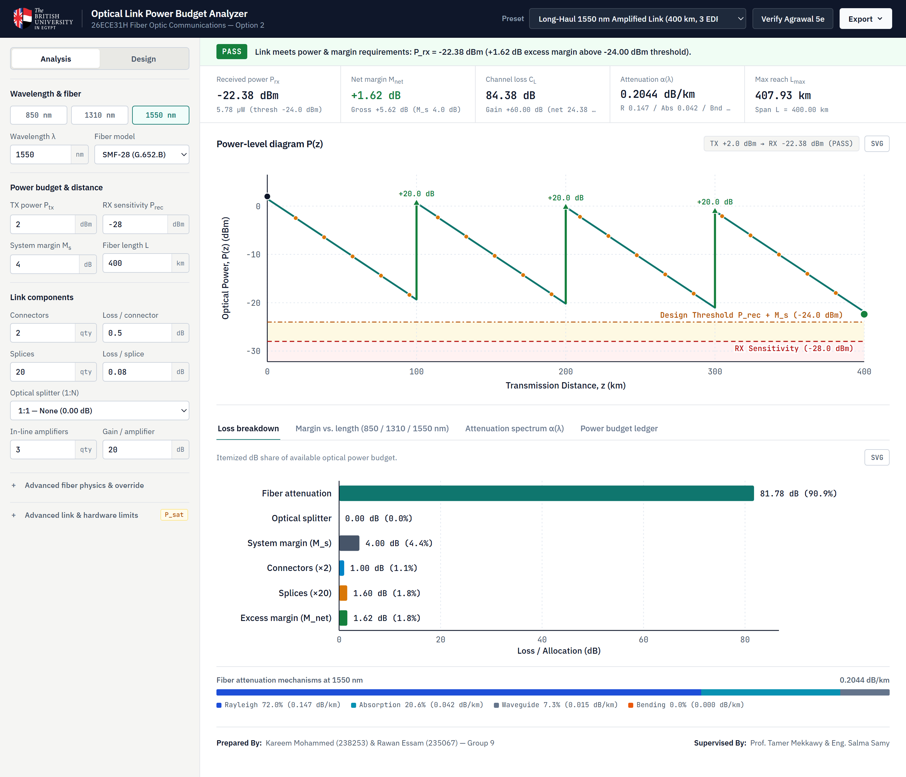

<p align="center">
  
</p>

<h1 align="center">Optical Link Power Budget &amp; Attenuation Analyzer (26ECE31H — Option 2)</h1>

<h4 align="center">Live Interactive Web Tool: <a href="https://optical.kareemmas3ud.me/">https://optical.kareemmas3ud.me/</a></h4>
<h4 align="center">Course: 26ECE31H Fiber Optic Communications &nbsp;|&nbsp; The British University in Egypt (Group 9)</h4>

---

## 1. Description

The **Optical Link Power Budget & Attenuation Analyzer** is a modular, physics-driven engineering workstation built for **26ECE31H — Fiber Optic Communications (Option 2)** at The British University in Egypt (BUE). It combines a zero-commercial-dependency **Python 3 / NumPy physics engine** (`physics_engine.py`) with a bespoke **local web workstation** (`app.py` + `web/`) and a **zero-install browser-hosted mirror** live at <https://optical.kareemmas3ud.me/> (`docs/`).

Engineers and students can model wavelength-dependent silica fiber losses across 800–1700 nm, trace end-to-end spatial optical power profiles $P(z)$ across discrete connectors, splices, passive splitters, and lumped in-line EDFAs, solve directly for maximum link reach or required amplifier counts, and verify every equation live against Govind P. Agrawal's *Fiber-Optic Communication Systems* (5th Ed., 2021).

### Multi-Mechanism Silica Attenuation Modeling
- Decomposes total silica fiber attenuation $\alpha_{\text{total}}(\lambda)$ [dB/km] across **800–1700 nm** into **Rayleigh scattering** ($C_R / \lambda^4$), **intrinsic UV electronic** and **IR multiphoton absorption tails** (Miya et al.), **extrinsic $\text{OH}^-$ water-vapor resonance peaks** (1385, 1240, and 950 nm), **waveguide imperfection floor**, and **macrobending / microbending losses** with wavelength-dependent confinement scaling ($R_{c,\text{eff}} \propto \lambda^3$).
- Includes calibrated presets for **Standard SMF-28 (ITU-T G.652.B, 15 ppb $\text{OH}^-$)**, **Low-Water-Peak Dry SMF (ITU-T G.652.D, 0.5 ppb $\text{OH}^-$)**, and **GRIN Multimode 50/125 $\mu$m**, plus direct cable attenuation override ($\alpha_f$) for datasheet or textbook problems.

### Real-Time Link Power Budgeting & Design Mode Solvers
- Evaluates end-to-end channel loss $C_L$, received optical power $P_{\text{rx}}$ (in both dBm and mW/$\mu$W), gross/net link margins ($M_{\text{gross}}, M_{\text{net}}$), receiver overload limits, and **PASS / FAIL** diagnostics across connectors, fixed or cable-reel splices, passive $1:N$ splitters, and periodic in-line EDFAs with optional output saturation clamping ($P_{\text{sat,out}}$).
- **Spatial Power-Level Diagram $P(z)$:** Traces continuous Beer–Lambert fiber decay alongside vertical drops at connectors, splices, and splitters and vertical gain jumps at each EDFA, flagging intermediate receiver sensitivity floor violations.
- **Design Mode Solvers:** Inverts the power budget to solve for **Maximum Feasible Reach ($L_{\text{max}}$)** (exact discrete reel splicing + saturation bisection) or **Minimum Required Amplifiers ($N_{\text{amp}}$)** with uniform span length $L_A$, per-span loss, and amplifier coordinates $z_k$.

### Automated Textbook Validation (Agrawal 5th Ed.)
- Ships with `validate_agrawal.py` (and a live **"Verify Agrawal 5e"** modal inside the GUI) executing **27 automated assertions** across four verified benchmarks from Agrawal 5th Ed.:
  1. **Ch. 5, Sec. 5.2.3, Table 5.1 (pp. 158–159):** 0.85 $\mu$m, 100 Mb/s Laser+PIN, LED+PIN, and LED+APD link budgets & photon-budget sensitivity.
  2. **Ch. 5, Problem 5.4 (pp. 179–180):** 1.3 $\mu$m LED link with 2 km cable-reel splicing.
  3. **Ch. 2, Eq. (2.5.4) & Sec. 2.5.4 (p. 48):** 1550 nm Rayleigh scattering bounds and macrobending threshold.
  4. **Ch. 7, Sec. 7.1.2 (p. 237):** 400 km periodic lumped amplification (`N_amp = 3`, `L_span = 100 km`, `G_A = 20 dB`).
- Achieves **27/27 PASS with `0.0000%` relative error** across both Python and browser-native engines.

---

## 2. Tech Stack

- **Core Physics Kernel:** Python 3.13, `NumPy`, typed JSON-serializable `dataclasses` (zero commercial or web dependencies).
- **Local Web Backend:** Python standard-library `ThreadingHTTPServer` (`app.py`) exposing clean REST JSON endpoints (`/api/presets`, `/api/analyze`, `/api/design`, `/api/validate`) with automatic port fallback and browser launch.
- **Frontend Optical Bench UI:** Semantic HTML5, custom responsive CSS3, Vanilla ES6+ JavaScript, **100% offline native SVG plotting** (interactive hover crosshairs, dynamic label de-overlapping), `IBM Plex Sans` & `JetBrains Mono` typography (`tabular-nums`).
- **Static Cloud Deployment:** Pure-JavaScript browser engine (`docs/engine_browser.js`) verified to **`0.00e+00` numerical difference** against Python, hosted on **GitHub Pages** (`/docs` on `main`) with enforced HTTPS on custom domain `optical.kareemmas3ud.me`.
- **Scientific Reporting Pipeline:** `Matplotlib` 300 DPI figure generator (`generate_report_figures.py`), automated textbook validation suite (`validate_agrawal.py`), and publication-grade technical report (`Group9_Option2_Report.pdf`).

---

## 3. File Structure & Component Breakdown

```text
optical-link-budget/
├── app.py                              # Zero-dependency local HTTP API & static file server
├── physics_engine.py                   # Pure Python + NumPy optical physics & Design Mode solvers
├── validate_agrawal.py                 # 27-check automated Agrawal 5th Ed. verification suite
├── generate_report_figures.py          # 300 DPI Matplotlib publication figure generator
├── Run_Optical_Link_Tool.bat           # One-click Windows launcher (auto-detects Python)
├── Group9_Option2_Report.pdf           # 8-page technical engineering report
├── README.md                           # Project documentation & engineering showcase (this file)
├── README.txt                          # Quick-start plain-text guide bundled in submission ZIP
├── web/                                # Local offline HTML5/CSS/JS workstation
│   ├── index.html                      # Instrument layout, control rail, telemetry strip & modals
│   ├── styles.css                      # Flat optical-bench styling + 390px mobile responsiveness
│   ├── app.js                          # Reactive state, REST client, native SVG charts & exports
│   └── bue-logo.png                    # High-contrast BUE crest for dark instrument bezel
├── docs/                               # Self-contained static GitHub Pages mirror
│   ├── CNAME                           # Custom domain binding (optical.kareemmas3ud.me)
│   ├── engine_browser.js               # Pure-JS port of physics_engine.py & validate_agrawal.py
│   ├── index.html                      # Static mirror entry point (relative asset paths)
│   ├── styles.css                      # Byte-identical mirror of web/styles.css
│   ├── app.js                          # Routes API calls locally through window.OpticalEngine
│   └── bue-logo.png                    # BUE crest asset
└── report_figures/                     # Generated 300 DPI PNG figures for documentation & report
    ├── fig0_attenuation_spectrum.png   # 800–1700 nm decomposed silica attenuation spectrum
    ├── fig1_power_level_diagram.png    # Spatial power-level diagram P(z) with drops & EDFAs
    ├── fig2_loss_breakdown.png         # FTTH GPON loss breakdown & macrobending share
    ├── fig3_margin_vs_length.png       # Multi-wavelength net margin M_net(L) comparison
    ├── fig4_agrawal_validation.png     # Agrawal 5e Table 5.1 worked example validation
    ├── fig5_gui_screenshot.png         # Live workstation screenshot
    └── fig_methodology_block_diagram.png # System architecture block diagram
```

### Component Roles
- **`physics_engine.py`**: Single source of truth for unit conversions (`dBm ↔ mW`, `dB/km ↔ km⁻¹`), photon-budget sensitivity, multi-mechanism silica attenuation, discrete component modeling, ordered spatial profile tracing $P(z)$, Design Mode solvers (`solve_max_reach`, `solve_required_amplifiers`), multi-wavelength margin sweeps, and 6 reference link presets.
- **`app.py`**: Lightweight multithreaded local HTTP server binding `127.0.0.1:8080` (with automatic port fallback), serving `web/` static files and JSON endpoints: `GET /api/presets`, `GET /api/validate`, `POST /api/analyze`, and `POST /api/design`.
- **`validate_agrawal.py`**: Standalone CLI and importable verification runner testing 27 analytical checkpoints against Agrawal 5th Ed. with strict `< 0.1%` tolerance.
- **`web/` & `docs/`**: Identical interactive optical bench UI featuring real-time SVG plots (`Power-Level Diagram P(z)`, `Loss Breakdown`, `Margin vs. Length`, `Attenuation Spectrum`), itemized power-budget ledger, live validation modal, contextual FAIL quick-fix buttons, and CSV / JSON / SVG / HiDPI PNG / Print-PDF exports. `docs/engine_browser.js` executes the full physics engine client-side for instant zero-server GitHub Pages hosting.
- **`generate_report_figures.py`**: Produces all 300 DPI publication figures in `report_figures/` directly from `physics_engine.py` outputs to guarantee numerical consistency between code, GUI, and technical report.

---

## 4. Design Choices & Engineering Decisions

### 1. Precision Optical Instrument Design Language
Instead of generic SaaS dashboard cards, the interface is modeled after a benchtop **OTDR / optical spectrum analyzer**: a dark slate header bezel (`#0F172A`) framing the white-text BUE crest, an alabaster control rail (`#F5F5F3`) separated by 1px drafting hairlines from a pure white analytical stage (`#FFFFFF`), strict `tabular-nums` monospace telemetry, calibrated optical-window color coding (**850 nm** vermilion, **1310 nm** cobalt, **1550 nm** deep teal), and collapsed accordion drawers that keep advanced physics controls accessible without cluttering core Option 2 inputs.

### 2. Zero-Commercial-Dependency Backend & 100% Offline Native SVG Plotting
Course evaluation requires the tool to run reliably offline without MATLAB, OptiSystem, Flask, Streamlit, or CDN-dependent charting frameworks. Using Python's standard-library `ThreadingHTTPServer` alongside custom native SVG renderers in `app.js` guarantees instant cold starts, crisp resolution-independent vector exports (`SVG` & 2× HiDPI `PNG`), interactive hover crosshairs, and zero broken charts when disconnected from the internet.

### 3. Dual-Runtime Numerical Parity (Python Kernel + Pure-JS Browser Mirror)
To let instructors, peers, and portfolio reviewers test the tool instantaneously without installing Python, `docs/engine_browser.js` implements a clean, exact JavaScript mirror of `physics_engine.py` and `validate_agrawal.py`. An automated Node.js vs. Python parity harness verifies **`0.00e+00` maximum absolute difference** across all 6 presets, 361-point attenuation spectra, 181-point multi-wavelength sweeps, both Design Mode solvers, and all 27 Agrawal benchmarks.

### 4. Physical Fidelity: EDFA Output Saturation Clamping & Reel-Spaced Splicing
Ideal linear link budgets often overlook real hardware limits. The spatial power tracer $P(z)$ supports **EDFA output power saturation clamping** ($G_{\text{eff},k} = \min(G_{\text{amp}}, \max(0, P_{\text{sat,out}} - P_{\text{in},k}))$), **receiver overload detection** ($P_{\text{rx}} \le P_{\text{overload}}$), and both **fixed splice counts** and **discrete cable-reel splicing** (adding an interior splice every $L_{\text{reel}}$ km, accurately matching Agrawal Problem 5.4). When saturation clamping is active, Design Mode automatically invokes spatial bisection to guarantee the solved reach or amplifier count passes full $P(z)$ verification.

### 5. Automated 27-Point Textbook Verification Gate
Every core equation in `physics_engine.py` carries inline Agrawal 5th Ed. section and equation references and is continuously gated by `validate_agrawal.py`. Making this exact suite runnable inside the GUI via **"Verify Agrawal 5e"** turns theoretical validation into an interactive, inspectable feature rather than a static claim.

### 6. Mobile-Responsive Instrument Reflow & Contextual FAIL Quick-Fix
The CSS architecture (`web/styles.css` & `docs/styles.css`) reflows cleanly down to **390px mobile viewports** with zero horizontal overflow (`scrollWidth === innerWidth`), stacking the header into a clean brand bar + full-width preset picker + side-by-side action buttons, and collapsing the 5-metric telemetry rail into a 2-column grid. Whenever a link fails in Analysis Mode ($M_{\text{net}} < 0\text{ dB}$), contextual one-click quick-fix actions—**Apply Max Reach ($L_{\text{max}}$)** and **Auto-Add Amplifiers**—appear directly inside the red FAIL banner to resolve the deficit immediately.

---

## 5. Setup & Installation Guide

### Prerequisites
- **Python 3.10+** (tested on Python 3.13)
- **NumPy** (required for `physics_engine.py`, `validate_agrawal.py`, and `app.py`):
  ```bash
  py -m pip install numpy
  ```
- **Matplotlib** *(optional — only needed to regenerate the 300 DPI figures)*:
  ```bash
  py -m pip install matplotlib
  ```

### Running Locally

1. **One-Click Windows Launch:**
   Double-click `Run_Optical_Link_Tool.bat` in the project root. It automatically detects Python, checks NumPy, starts `app.py`, and opens the workstation in your default browser.

2. **Command-Line Launch (Cross-Platform):**
   ```bash
   py app.py
   ```
   Optional flags:
   ```bash
   py app.py --port 8080      # Specify preferred local port (auto-falls back if busy)
   py app.py --no-browser     # Start server without auto-opening a browser tab
   ```

3. **Run the 27-Check Agrawal 5th Ed. Validation Suite:**
   ```bash
   py validate_agrawal.py
   ```

4. **Regenerate 300 DPI Report Figures:**
   ```bash
   py generate_report_figures.py
   ```

5. **Zero-Install Live Web Version:**
   Visit <https://optical.kareemmas3ud.me/> directly from any desktop or mobile browser.

### Interactive Usage Workflow
- **Load Reference Scenarios:** Choose any of the 6 presets in the top bar (Agrawal Table 5.1 Laser/LED/APD, Metro 1310 nm SMF, Long-Haul 1550 nm Amplified 400 km, or FTTH GPON 1:32).
- **Analysis Mode:** Tune wavelength (`850 / 1310 / 1550 nm` or custom), fiber model, TX/RX power, margin, length, connectors, splices, splitter, or EDFAs and observe real-time PASS/FAIL telemetry and spatial $P(z)$ traces. Use the **FAIL** banner's one-click quick-fix buttons if a link exceeds budget.
- **Design Mode:** Switch to the **Design** tab to solve for **Maximum Reach ($L_{\text{max}}$)** or **Required Amplifiers ($N_{\text{amp}}$)** for a target length, then click **Apply to link** to commit the solution.
- **Verify & Export:** Click **Verify Agrawal 5e** to inspect all 27 live textbook assertions, or click **Export** to download CSV budgets, JSON configurations, standalone SVGs, 2× HiDPI PNGs, or print-ready PDF summaries.

---

## 6. Team & Supervision

### Prepared By (Group 9)
- **Kareem Mohammed Abdullah (`238253`)** — *Electrical & Communication Engineering (BUE / LSBU Dual Degree) | Vice Chair, IEEE BUE | COP31 UNDP Fellow*  
  Email: [kareemmas3ud@ieee.org](mailto:kareemmas3ud@ieee.org) &nbsp;|&nbsp; LinkedIn: [linkedin.com/in/kareemmasoud](https://linkedin.com/in/kareemmasoud)
- **Rawan Essam (`235067`)** — *Electrical & Communication Engineering (BUE / LSBU Dual Degree)*

### Supervised By
- **Prof. Tamer Mekkawy** & **Eng. Salma Samy** — Faculty of Engineering, The British University in Egypt (BUE)
